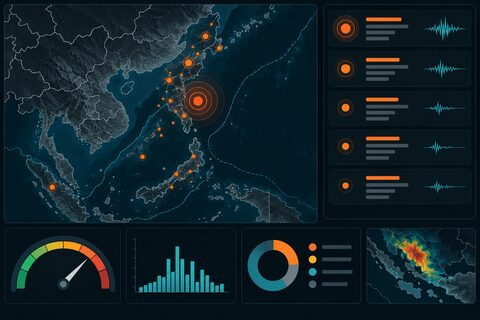

# Graph Run Status Page

Purpose: sketches an operator-facing status page rendered entirely through a graph.

Current behavior: uses static execution/job data and renders a compact run summary in HTML.

Architecture note: later this can be wired to real execution APIs or internal admin nodes once auth/RBAC boundaries exist.
