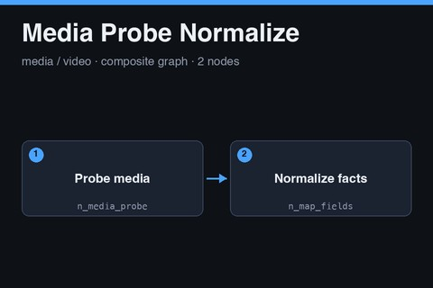

# Media Probe Normalize

<a href="media-probe-normalize.subfork.json" download="media-probe-normalize.subfork.json" aria-label="Download graph" title="Download graph"><svg xmlns="http://www.w3.org/2000/svg" width="16" height="16" viewBox="0 0 24 24" fill="none" stroke="currentColor" stroke-width="2" stroke-linecap="round" stroke-linejoin="round" aria-hidden="true"><path d="M12 3v12m-5-5 5 5 5-5M5 16v5h14v-5"/></svg></a>

A reusable probe for one audio or video artifact. It reads the file's technical facts
with the Media Probe node and projects them into a stable, small shape with a mapping,
so downstream nodes depend on fixed field names rather than the raw probe layout. Use it
for clip durations, QA measurements, or upload verification. Import it independently, or
publish it as a composite.

The graph needs a worker with the `media-worker` capability. It makes no network
requests, needs no credentials, and has no side effects. Media Probe runs with a
15-second timeout.

## Data flow

1. **Probe media** (`n_media_probe`) inspects the `artifact` input and emits the raw probe
   information.
2. **Normalize facts** (`n_map_fields`) copies fields from the raw information into the
   shape given by `mapping`.

## Inputs and outputs

| Input | Type | Meaning |
| --- | --- | --- |
| `artifact` | `artifact` | Required audio or video file, for example an uploaded asset |
| `mapping` | `json` | Optional map from output field names to probe field names |

| Output | Type | Meaning |
| --- | --- | --- |
| `facts` | `json` | The projected facts |
| `raw` | `json` | The unmodified probe information |

The default mapping carries `duration_seconds`, `width`, `height`, `fps`, and `has_audio`
across under the same names. That is a guess at the probe's key layout. Run the graph
once, compare `raw` with `facts`, and adjust `mapping` if a field comes back empty.

## Authentication and security

There is nothing to wire. The graph holds no credentials and calls no service. Probe
output can include file metadata such as titles and encoder tags, so treat `raw` as
untrusted input when it is displayed or passed to another service.

## Recommended panels

Use a JSON Inspector for `facts` and `raw`, and Activity or Logs to see worker errors.

## Using it as a composite

Publish the graph and call it from a parent that produces or receives an `artifact`, such
as a render step or an upload. Connect `facts` to checks like a duration limit, and keep
`raw` for diagnostics.

## Validation status

The graph passes the repository validator and the node-catalog check against the production catalog, and the Subfork server-side validate endpoint (`POST /graphs/validate`) accepted it on 2026-11-05. It has not been executed on a media worker, so the default
mapping is unconfirmed, and whether the account plan includes the `media-worker` capability has not
been verified.

No Subfork platform version could be found on the public API or site, so this note records the check date and the node catalog instead: on 2026-11-05 the catalog served 75 node types, and every node in this graph is version `1.0.0`.
