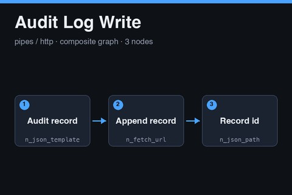

# Audit Log Write

<a href="audit-log-write.subfork.json" download="audit-log-write.subfork.json" aria-label="Download graph" title="Download graph"><svg xmlns="http://www.w3.org/2000/svg" width="16" height="16" viewBox="0 0 24 24" fill="none" stroke="currentColor" stroke-width="2" stroke-linecap="round" stroke-linejoin="round" aria-hidden="true"><path d="M12 3v12m-5-5 5 5 5-5M5 16v5h14v-5"/></svg></a>

A reusable audit-record append built from generic nodes. It builds one record from
an actor, an action, a subject ID, and a payload, POSTs it to a sink URL the caller
supplies, and reads the new record's `id` from the response. Use it to leave a
durable trail of approvals, write-backs, exports, or filings from any parent graph.
Import it independently, or publish it as a composite.

**This graph performs an externally visible write.** Every successful run appends a
record at the sink. Re-running after an ambiguous timeout can append a duplicate,
and the graph cannot delete a record it wrote. The graph references no secrets,
environment-specific graph IDs, or generated media.

## Data flow

1. **Audit record** (`n_json_template`) builds `actor`, `action`, `subject_id`,
   `payload`, and an optional `occurred_at`.
2. **Append record** (`n_fetch_url`) POSTs the record to `sink_url` with the
   `headers` input. The request has a 30-second timeout. The response-size limit
   is the node default.
3. **Record id** (`n_json_path`) reads `id` from the JSON response.

## Inputs and outputs

| Input | Type | Meaning |
| --- | --- | --- |
| `sink_url` | `url` | Required endpoint that accepts the record. Receives the `headers` value |
| `headers` | `json` | Required request headers, built by the parent graph |
| `actor` | `str` | Required identity that performed the action |
| `action` | `str` | Required short action name |
| `subject_id` | `str` | Required identifier of the thing acted on |
| `payload` | `json` | Required structured details of the action |
| `occurred_at` | `str` | Optional timestamp the caller supplies |

| Output | Type | Meaning |
| --- | --- | --- |
| `record_id` | `json` | The `id` field of the sink response |
| `response` | `json` | The full JSON response from the sink |
| `status` | `int` | HTTP status code |

Subfork has no clock node, so the graph cannot stamp the time itself. Pass
`occurred_at` from the parent or let the sink stamp the record. The record template
marks that key as optional (`occurred_at?`); omission of the field when the input is
absent is assumed and has not been confirmed in a live run.

## Authentication

The graph never holds a credential. The parent builds the headers from its own
secrets and passes them in:

1. In the parent, add a JSON Template node with the template
   `{"Authorization": "Bearer {{ secrets.AUDIT_SINK_TOKEN }}", "Content-Type": "application/json"}`.
2. Connect its `value` output to this graph's `headers` input.
3. Add the secret `AUDIT_SINK_TOKEN` in the parent graph's **Graph Settings →
   Execution Profile**. Never paste a token into a graph, a fixture, or these notes.

Use whatever header names and secret name your sink requires. Whether node outputs
and execution logs redact header values has not been verified, so do the first run
with a throwaway token and inspect the logs before using a real one.

## Security guidance

- **Use a literal URL in the parent graph.** `sink_url` receives the headers,
  including the token. Do not feed it from request data, model output, or any other
  untrusted value.
- **Use a low-privilege, append-only token.** The token should allow creating
  records and nothing else. Do not reuse it for other services.
- **Do not put secrets in `payload`.** Records are stored by the sink and are
  usually readable by more people than the original data.

## Retry and duplication

The graph does not retry and does not send an idempotency key. If the sink supports
one, add it to the payload or the headers from the parent. After a timeout, look
for the record at the sink before running again.

## Using it as a composite

Publish the graph, pin the version, and call it from a parent after the step you
want to record. Connect the step's result into `payload` and `subject_id`, and use
`record_id` to link the record from later steps.

## Validation status

The graph passes the repository validator and the node-catalog check against the production catalog, and the Subfork server-side validate endpoint (`POST /graphs/validate`) accepted it on 2026-11-05.

It was imported and executed once on subfork.com on 2026-11-05 by anthonyshafer@gmail.com, and the
run completed. The run POSTed fixture values to the public test endpoint
`https://jsonplaceholder.typicode.com/posts`, not a real audit sink, with no credentials. The
endpoint answered 201 with an `id` of 101, which the graph returned as `record_id`, and a JSON
object passed as `payload` was sent as an object. Its nodes, edges, and graph inputs and outputs
match this file; the test run only filled in `sink_url`, `headers`, and the record fields. Whether
the endpoint stored the record was not checked. Behavior against a real sink, idempotency, and
header redaction in logs are unverified.

No Subfork platform version could be found on the public API or site, so this note records the check date and the node catalog instead: on 2026-11-05 the catalog served 75 node types, and every node in this graph is version `1.0.0`.
