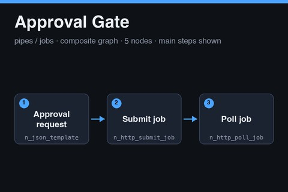

# Approval Gate

<a href="approval-gate.subfork.json" download="approval-gate.subfork.json" aria-label="Download graph" title="Download graph"><svg xmlns="http://www.w3.org/2000/svg" width="16" height="16" viewBox="0 0 24 24" fill="none" stroke="currentColor" stroke-width="2" stroke-linecap="round" stroke-linejoin="round" aria-hidden="true"><path d="M12 3v12m-5-5 5 5 5-5M5 16v5h14v-5"/></svg></a>

A reusable human-approval step built from the same submit-and-poll nodes as
[Job Run](job-run.notes.md). It asks an HTTP service to open an approval request for a
person, then polls until the request is approved, rejected, or expired. The job `kind`
is fixed to `approval`. Import it independently, or publish it as a composite.

**Submitting the request is an externally visible write.** A successful run creates an
approval request at the service, which may notify the approver. A retry can create a second
request unless the service honors the idempotency key. The graph references no secrets,
environment-specific graph IDs, or generated media.

## Read this first: the gate does not block by itself

Subfork has no pause or skip node. This graph can only order work after it by data
flow, for example by wiring `decision` into an input of the node that performs the
effect. The poll node lists `rejected` and `expired` as failure statuses, but whether a
failed poll stops the nodes that depend on it has not been verified. A rejected approval
might still let a downstream node run.

Do not rely on this graph alone to protect an action. **The service that performs the
effect must confirm the approval itself** before acting: read the job at its
`status_url` and require status `completed`. Treat this graph as the way to request and
wait for an approval, and the effect service as the enforcement point.

## Data flow

1. **Approval request** (`n_json_template`) builds the request body with `kind` set to
   `approval`, the `idempotency_key`, and `params` holding `subject`, `summary`,
   `approver`, and `expires_in_seconds` (900). The optional `payload` is sent as the job
   `inputs`.
2. **Jobs endpoint** (`n_url_builder`) appends `jobs` to `base_url`.
3. **Submit job** (`n_http_submit_job`) POSTs the body and reads the job `id` and
   `status_url`.
4. **Poll job** (`n_http_poll_job`) calls the `status_url` every 30 seconds for up to 900
   seconds. `completed` ends the poll successfully. `failed`, `cancelled`, `rejected`,
   and `expired` are failure statuses.

The 900-second request expiry and the 900-second poll budget are set to match. The
longest wall time a single run can wait has not been verified, so confirm a 15-minute
approval fits in one run on your instance.

## Inputs and outputs

| Input | Type | Meaning |
| --- | --- | --- |
| `base_url` | `url` | Required service base URL; the graph posts to `{base_url}/jobs`. Receives the `headers` value |
| `headers` | `json` | Required request headers, built by the parent graph |
| `subject` | `str` | Required short title of what needs approval |
| `summary` | `str` | Required description for the approver |
| `approver` | `str` | Optional approver identifier the service understands; defaults to empty |
| `payload` | `json` | Optional structured details; defaults to an empty object |
| `idempotency_key` | `str` | Required key that makes a repeated request return the same approval |

| Output | Type | Meaning |
| --- | --- | --- |
| `decision` | `json` | The final status body |
| `status` | `str` | The final status, normalized to lowercase by the poll node |
| `remote_job` | `json` | The resumable job reference |

The service is expected to follow the submit and poll shape described in
[Job Run](job-run.notes.md), with `rejected` and `expired` as terminal statuses in
addition to the usual ones. Put a content version in the idempotency key, for example
`<item id>:approval:<content hash or version>`, so changed content gets a new request.

## Authentication

The graph never holds a credential. The parent builds the headers from its own secrets
and passes them in:

1. In the parent, add a JSON Template node with the template
   `{"Authorization": "Bearer {{ secrets.JOB_SERVICE_TOKEN }}", "Content-Type": "application/json"}`.
2. Connect its `value` output to this graph's `headers` input.
3. Add the secret `JOB_SERVICE_TOKEN` in the parent graph's **Graph Settings →
   Execution Profile**. Never paste a token into a graph, a fixture, or these notes.

Whether node outputs and execution logs redact header values has not been verified, so
do the first run with a throwaway token and inspect the logs before using a real one.

## Security guidance

- **Use a literal `base_url` in the parent graph.** It receives the headers, including
  the token. Do not feed it from request data, model output, or any other untrusted
  value.
- **Use a token that can request approvals but cannot grant them.** Do not give this
  graph the approver's token. If the graph's token could approve its own requests, the
  gate would mean nothing.
- **Keep `status_url` on the same host as `base_url`.** The poll node calls whatever
  `status_url` the service returns, with the same headers. Whether the node enforces a
  same-host rule has not been verified, so only point this graph at a service you
  control or trust.

## Using it as a composite

Publish the graph, pin the version, and call it from a parent ahead of the step you want
guarded. Connect `decision` to the guarded step's inputs so it runs after the gate, and
make the guarded service check the approval on its own as described above. Connect
`status` to a details or JSON panel so an operator can see the outcome.

## Validation status

The graph passes the repository validator and the node-catalog check against the production catalog, and the Subfork server-side validate endpoint (`POST /graphs/validate`) accepted it on 2026-11-05. It has not been executed, so it has not been run against a live
job service and no approval request was created. Whether a failed poll halts dependent nodes is
unverified, as described above.

No Subfork platform version could be found on the public API or site, so this note records the check date and the node catalog instead: on 2026-11-05 the catalog served 75 node types, and every node in this graph is version `1.0.0`.
