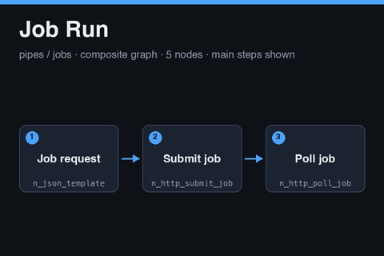

# Job Run

<a href="job-run.subfork.json" download="job-run.subfork.json" aria-label="Download graph" title="Download graph"><svg xmlns="http://www.w3.org/2000/svg" width="16" height="16" viewBox="0 0 24 24" fill="none" stroke="currentColor" stroke-width="2" stroke-linecap="round" stroke-linejoin="round" aria-hidden="true"><path d="M12 3v12m-5-5 5 5 5-5M5 16v5h14v-5"/></svg></a>

A reusable submit-and-poll graph for any long-running HTTP job: scoring, verification,
research, builds, or other work that a service runs asynchronously. It builds a job
request, POSTs it to `{base_url}/jobs`, polls the status URL the service returns, and
reports the final status body. It is generic by design and does not know what the job
does. Import it independently, or publish it as a composite.

This is submit and poll, not scheduling. Each run creates one job.

**Submitting a job is an externally visible write.** A successful run starts work at
the service, and a retry can start it twice unless the service honors the
idempotency key described below. The graph references no secrets,
environment-specific graph IDs, or generated media.

## Data flow

1. **Job request** (`n_json_template`) builds the request body from `kind`,
   `idempotency_key`, `params`, and `inputs`.
2. **Jobs endpoint** (`n_url_builder`) appends `jobs` to `base_url`.
3. **Submit job** (`n_http_submit_job`) POSTs the body. It reads the job `id` and the
   `status_url` from the response, and uses an optional integer `poll_after_seconds`
   hint when the service sends one (5 seconds otherwise).
4. **Poll job** (`n_http_poll_job`) calls the `status_url`, sends the same headers, and
   waits between attempts until the status is terminal.

## Inputs and outputs

| Input | Type | Meaning |
| --- | --- | --- |
| `base_url` | `url` | Required service base URL; the graph posts to `{base_url}/jobs`. Receives the `headers` value |
| `headers` | `json` | Required request headers, built by the parent graph |
| `kind` | `str` | Required job type the service understands |
| `idempotency_key` | `str` | Required key that makes a repeated submission return the same job |
| `params` | `json` | Optional job parameters; defaults to an empty object |
| `inputs` | `json` | Optional job inputs; defaults to an empty object |

| Output | Type | Meaning |
| --- | --- | --- |
| `result` | `json` | The final status body |
| `status` | `str` | The final status, normalized to lowercase by the poll node |
| `remote_job` | `json` | The resumable job reference |
| `media` | `media` | The media URL from the status body, when the service returns one |

## Service contract

The graph works with any HTTP service that follows this shape.

**Submit.** `POST {base_url}/jobs` with a JSON body holding `kind`, `idempotency_key`,
`params`, and `inputs`. The service answers 200 or 202 with `id`, `status` (normally
`queued`), and `status_url`. It may add an integer `poll_after_seconds` to say how long
to wait before the first poll. A repeated `idempotency_key` should return the existing
job rather than create another, and the same key with different parameters should be
rejected. Put a content version in the key, for example
`<item id>:<kind>:<content hash or version>`.

**Poll.** `GET {status_url}` returns `id`, `status`, `kind`, `url`, `result`, and
`error`. `status` is one of `queued`, `running`, `completed`, `failed`, `cancelled`,
`rejected`, or `expired`. `url` is the media URL once the job completes, and `result`
holds structured output. `error` describes a failure.

**Terminal handling in this graph.** `completed` ends the poll successfully. `failed`
and `cancelled` count as failures. `rejected` and `expired` are used by approval-style
services; this graph does not list them as failures, so a service that returns them
would be polled until the limits below. Use [Approval Gate](approval-gate.notes.md)
for those, or edit the poll node's failure values.

## Polling limits

Polling waits 5 seconds between attempts by default, stops after 120 attempts or 3,600
seconds. The graph never sends a cancel request, so a job can keep running at the
service after polling stops.

## Authentication

The graph never holds a credential. The parent builds the headers from its own secrets
and passes them in:

1. In the parent, add a JSON Template node with the template
   `{"Authorization": "Bearer {{ secrets.JOB_SERVICE_TOKEN }}", "Content-Type": "application/json"}`.
2. Connect its `value` output to this graph's `headers` input.
3. Add the secret `JOB_SERVICE_TOKEN` in the parent graph's **Graph Settings →
   Execution Profile**. Never paste a token into a graph, a fixture, or these notes.

Whether node outputs and execution logs redact header values has not been verified, so
do the first run with a throwaway token and inspect the logs before using a real one.

## Security guidance

- **Use a literal `base_url` in the parent graph.** It receives the headers, including
  the token. Do not feed it from request data, model output, or any other untrusted
  value.
- **Use one low-privilege token per service.** Do not reuse a token across services.
- **Keep `status_url` on the same host as `base_url`.** The poll node calls whatever
  `status_url` the service returns, with the same headers. Whether the node enforces a
  same-host rule has not been verified, so only point this graph at a service you
  control or trust.

## Using it as a composite

Publish the graph, pin the version, and call it from a parent that supplies `base_url`
and `headers` as literals or from its own secrets. Keep polling at the top level of the
parent when possible. Connect `result` and `status` to downstream nodes, and `media` to
a media or video preview panel.

## Validation status

The graph passes the repository validator and the node-catalog check against the production catalog, and the Subfork server-side validate endpoint (`POST /graphs/validate`) accepted it on 2026-11-05. It has not been executed, so it has not been run against a live
job service and no job was submitted. Whether placeholders that stand alone in a template value
(`params` and `inputs`) keep their JSON type has not been confirmed for this graph in a live run.
Whether a poll that reaches a failure status raises a node error or only returns the status has not
been verified either.

No Subfork platform version could be found on the public API or site, so this note records the check date and the node catalog instead: on 2026-11-05 the catalog served 75 node types, and every node in this graph is version `1.0.0`.
