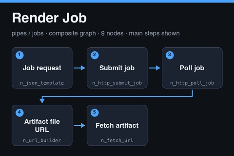

# Render Job

<a href="render-job.subfork.json" download="render-job.subfork.json" aria-label="Download graph" title="Download graph"><svg xmlns="http://www.w3.org/2000/svg" width="16" height="16" viewBox="0 0 24 24" fill="none" stroke="currentColor" stroke-width="2" stroke-linecap="round" stroke-linejoin="round" aria-hidden="true"><path d="M12 3v12m-5-5 5 5 5-5M5 16v5h14v-5"/></svg></a>

A reusable asynchronous media job that returns a file. It runs the same submit-and-poll
chain as [Job Run](job-run.notes.md), then reads the artifact location from the
finished job, rebuilds the file URL from the service base URL, and downloads the file as
a Subfork artifact. Use it for video renders, image generation, screenshots, or audio
post-processing that a service performs. Import it independently, or publish it as a
composite.

**Submitting a job is an externally visible write.** A successful run starts work at the
service, which can be slow and billed. A retry can start it twice unless the service
honors the idempotency key. The graph references no secrets, environment-specific graph
IDs, or generated media.

## Data flow

1. **Job request** (`n_json_template`) builds the body from `kind`, `idempotency_key`,
   `params`, and `inputs`.
2. **Jobs endpoint** (`n_url_builder`) appends `jobs` to `base_url`.
3. **Submit job** (`n_http_submit_job`) POSTs the body and reads the job `id` and
   `status_url`.
4. **Poll job** (`n_http_poll_job`) waits 5 seconds between attempts and stops after 120
   attempts or 3,600 seconds.
5. **Artifact segments** (`n_json_path`) reads `result.artifact_segments` from the final
   status body. This is a list of URL path segments.
6. **Artifact file URL** (`n_url_builder`) appends those segments to `base_url`.
7. **Fetch artifact** (`n_fetch_url`) GETs that URL with the same headers and stores the
   response as an artifact. The request has a 120-second timeout and a response cap of
   250,000,000 bytes, set explicitly for video. Confirm your instance accepts that
   value.

The file URL is built from `base_url`, never taken whole from the service response, so
the file request goes to the same host as the job request. The service controls only the
path segments.

## Inputs and outputs

| Input | Type | Meaning |
| --- | --- | --- |
| `base_url` | `url` | Required service base URL. Used for the jobs endpoint and the file URL, and receives the `headers` value |
| `headers` | `json` | Required request headers, built by the parent graph |
| `kind` | `str` | Required job type the service understands, for example a render type |
| `idempotency_key` | `str` | Required key that makes a repeated submission return the same job |
| `params` | `json` | Optional job parameters; defaults to an empty object |
| `inputs` | `json` | Optional job inputs; defaults to an empty object |

| Output | Type | Meaning |
| --- | --- | --- |
| `artifact` | `artifact` | The downloaded file |
| `media` | `media` | The media URL from the status body, when the service returns one |
| `result` | `json` | The final status body |
| `status` | `str` | The final status, normalized to lowercase by the poll node |

The service contract is the one described in [Job Run](job-run.notes.md), with one
addition: when a job completes, `result.artifact_segments` must hold the path segments of
the output file relative to the service base URL, and the file must be served from the
same host and accept the same headers. Put a content version in the idempotency key, for
example `<item id>:<kind>:<content hash or version>`.

## Authentication

The graph never holds a credential. The parent builds the headers from its own secrets
and passes them in:

1. In the parent, add a JSON Template node with the template
   `{"Authorization": "Bearer {{ secrets.JOB_SERVICE_TOKEN }}", "Content-Type": "application/json"}`.
2. Connect its `value` output to this graph's `headers` input.
3. Add the secret `JOB_SERVICE_TOKEN` in the parent graph's **Graph Settings →
   Execution Profile**. Never paste a token into a graph, a fixture, or these notes.

The same headers are sent on the submit, poll, and file requests. Whether node outputs
and execution logs redact header values has not been verified, so do the first run with a
throwaway token and inspect the logs before using a real one.

## Security guidance

- **Use a literal `base_url` in the parent graph.** It receives the headers, including
  the token, on all three requests. Do not feed it from request data, model output, or
  any other untrusted value.
- **Use one low-privilege token per service.** Do not reuse a token across services.
- **Keep `status_url` on the same host as `base_url`.** The poll node calls whatever
  `status_url` the service returns, with the same headers. Whether the node enforces a
  same-host rule has not been verified, so only point this graph at a service you
  control or trust.
- **Trust what the service renders.** Some services run project code or templates that
  you supply. Point the service only at inputs you control.

## Using it as a composite

Publish the graph, pin the version, and call it from a parent that supplies `base_url`
and `headers`. Connect `artifact` to storage or an upload step, and `media` to a Video or
Media Preview panel. Keep polling at the top level of the parent when possible.

## Validation status

The graph passes the repository validator and the node-catalog check against the production catalog, and the Subfork server-side validate endpoint (`POST /graphs/validate`) accepted it on 2026-11-05. It has not been executed, so it has not been run against a live
job service, no job was submitted, and no file was downloaded. Whether the platform accepts the
250,000,000 byte response cap, and whether a poll that reaches a failure status raises a node error
or only returns the status, have not been verified.

No Subfork platform version could be found on the public API or site, so this note records the check date and the node catalog instead: on 2026-11-05 the catalog served 75 node types, and every node in this graph is version `1.0.0`.
